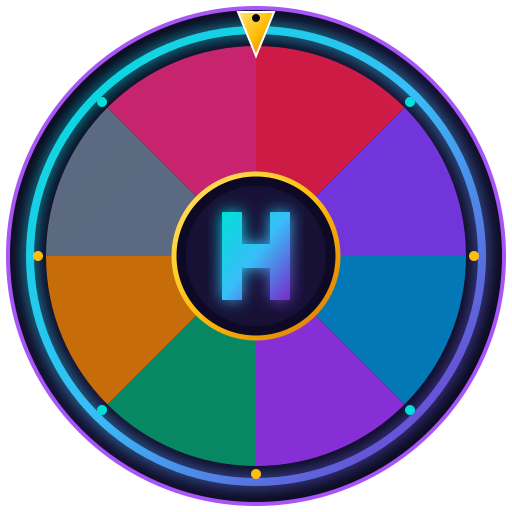

# Hayner Spin — Premium Android Spin App

<p align="center">
  
</p>

<p align="center">
  <strong>A modern, futuristic, mobile-first Android spinning wheel application built with Kotlin, Jetpack Compose, and React/Capacitor web architecture.</strong>
</p>

<p align="center">
  
  
  
  
</p>

---

## 🌟 Overview

**Hayner Spin** is a high-performance Android application featuring an advanced, customizable spinning wheel with authentic deceleration physics, mechanical pointer animations, zero-latency synthesized audio effects, haptic feedback, 6 dynamic color themes, and complete bilingual support for **English** and **Somali (Af-Soomaali)**.

---

## ✨ Features

- **🎯 Advanced Spinning Wheel**:
  - Real acceleration & quintic-ease deceleration curves.
  - Mathematically synchronized top pointer needle with spring deflection on segment pegs.
  - Zero-latency mechanical tick sounds and victory arpeggios synthesized via `AudioTrack`.
  - Haptic feedback pulses for needle pass and prize celebration.
  - 4 Spin Modes: *Standard*, *Custom Wheel*, *Quick Spin (1.5s)*, and clearly marked non-monetary *Practice Mode*.

- **🛠️ Custom Wheel Builder**:
  - Create, customize, duplicate, and delete custom wheels.
  - Live interactive preview as you edit.
  - Edit segment labels, pick from 12 vibrant colors, reorder spokes with move up/down.
  - Enforced guardrails: minimum 2, maximum 16 segments.

- **📜 Spin History & Statistics**:
  - Persistent local history log with timestamp, wheel name, outcome, and spin number.
  - Instant search and category filter chips (*All*, *Wins Only*, *Practice*).
  - Sort by newest/oldest and clear history with confirmation.

- **🎨 6 Futuristic Themes**:
  - 🌌 **Purple Galaxy** (Cosmic electric violet & cyan glow)
  - ⚡ **Neon Blue** (Cyberpunk electric blue & teal)
  - 👑 **Royal Gold** (Obsidian & champagne gold)
  - 🌿 **Emerald Night** (Deep jade & mint highlights)
  - 🔴 **Crimson Night** (Ruby & coral flame)
  - 🌑 **Minimal Dark** (Titanium & slate monochrome)

- **🌍 Bilingual English & Somali (Af-Soomaali)**:
  - Instant live language toggle across all buttons, dialogs, cards, and titles.

- **🔥 Daily Challenges & Streaks**:
  - Daily tasks: 3 spins today, try 2 themes, create a custom wheel, 5 practice spins.
  - Automatic streak tracker with consecutive day progression.

- **👤 User Profile & Custom Avatars**:
  - Local nickname editing and 8 futuristic avatar choices.
  - Lifetime spin counters and challenge reward points.

- **🔒 Offline-First & Private**:
  - Strictly 100% on-device storage. No telemetry or ad tracking.

---

## 📱 Android Build & Packaging

### Local APK Build (Using Gradle)

To compile the native Android Debug APK on your machine:

```bash
# Grant execution permissions
chmod +x gradlew

# Build Debug APK
gradle :app:assembleDebug
```

The compiled APK will be located at:
```
app/build/outputs/apk/debug/app-debug.apk
```

### Automated GitHub Actions Workflow

This repository includes a fully configured continuous integration workflow:
`.github/workflows/build-apk.yml`

1. Push your changes to the `main` or `master` branch, or navigate to **Actions** -> **Build Android APK** -> **Run workflow**.
2. GitHub Actions sets up JDK 17, installs the Android SDK, and compiles the project.
3. Download the generated `HaynerSpin-Debug-APK` directly from the workflow summary artifacts.

---

## 💻 Web & Capacitor Setup (Alternative)

If testing or developing the web/Capacitor bundle:

```bash
# Install dependencies
npm install

# Run local Vite development server
npm run dev

# Build production web bundle
npm run build

# Synchronize with Capacitor
npx cap sync android
```

---

## 📁 Project Structure

```
├── app/
│   ├── src/main/
│   │   ├── AndroidManifest.xml
│   │   ├── java/com/example/
│   │   │   ├── MainActivity.kt           # Main Compose entry & router
│   │   │   ├── audio/SoundEffects.kt     # PCM synthesizer & haptics
│   │   │   ├── data/HaynerPreferences.kt # SharedPreferences storage
│   │   │   ├── data/DefaultWheels.kt     # Default 8-segment Hayner wheel
│   │   │   ├── localization/Localization.kt # English & Somali dictionaries
│   │   │   ├── model/Models.kt           # Data classes & categories
│   │   │   ├── model/Enums.kt            # App theme, language & screen enums
│   │   │   ├── ui/components/
│   │   │   │   ├── SpinWheelCanvas.kt    # Custom Canvas wheel & pointer
│   │   │   │   ├── HaynerHeader.kt       # Top bar with logo & streak
│   │   │   │   ├── HaynerBottomNav.kt    # 5-destination bottom navigation
│   │   │   │   ├── SpinResultDialog.kt   # Celebration & reward modal
│   │   │   │   ├── GlassCard.kt          # Glassmorphic card surface
│   │   │   │   └── ConfirmDialog.kt      # Safe confirmation dialog
│   │   │   ├── ui/screens/
│   │   │   │   ├── SplashScreen.kt       # Animated launch screen
│   │   │   │   ├── OnboardingScreen.kt   # 3-step introduction
│   │   │   │   ├── HomeScreen.kt         # Dashboard with stats & hero wheel
│   │   │   │   ├── SpinScreen.kt         # Full interactive spin arena
│   │   │   │   ├── MyWheelsScreen.kt     # Custom wheels management
│   │   │   │   ├── WheelEditorScreen.kt  # Wheel builder with live preview
│   │   │   │   ├── HistoryScreen.kt      # Searchable spin history
│   │   │   │   ├── ProfileScreen.kt      # Avatar picker & lifetime stats
│   │   │   │   └── SettingsScreen.kt     # Theme, language, audio & legal
│   │   │   ├── ui/theme/                 # M3 Colors, Typography & Shapes
│   │   │   └── viewmodel/HaynerViewModel.kt # Spin engine & state coordinator
│   │   └── res/                          # Vector drawables, fonts & icons
├── .github/workflows/build-apk.yml        # Automated CI APK build
├── public/                               # Logo, favicon, icon & splash
├── src/                                  # Web React source code
├── package.json                          # Vite & Capacitor configuration
├── capacitor.config.ts                   # Capacitor mobile config
├── README.md                             # Documentation
└── LICENSE                               # MIT License
```

---

## ⚖️ Legal & Disclaimer

*Hayner Spin is designed solely for entertainment and personal decision-making. All segments, bonus spins, and rewards are simulated demonstration prizes with no monetary or real cash value. Real-money gambling and payouts are not supported.*

---

## 📄 License

Distributed under the **MIT License**. See `LICENSE` for more information.
